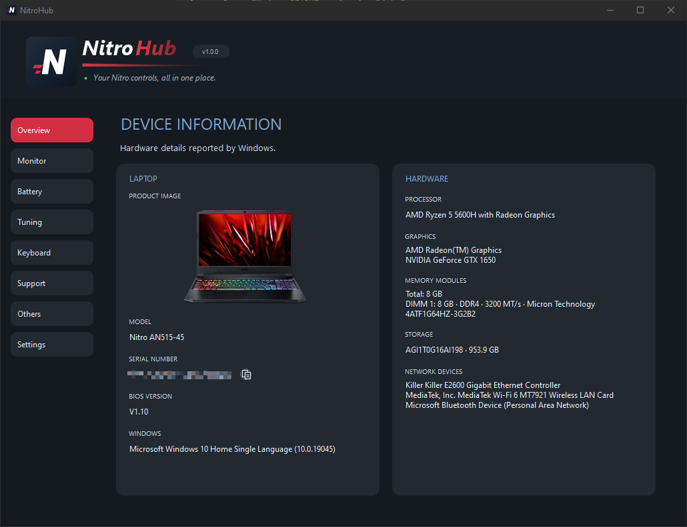
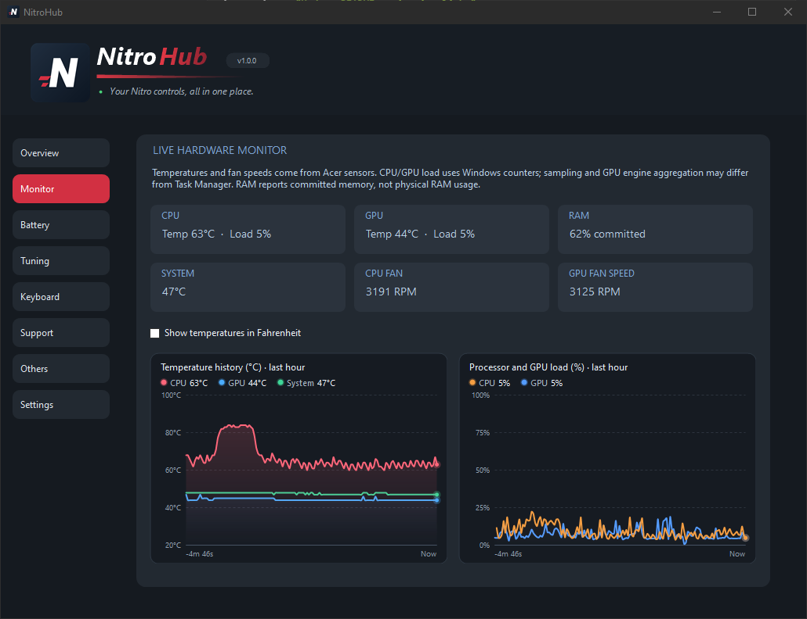
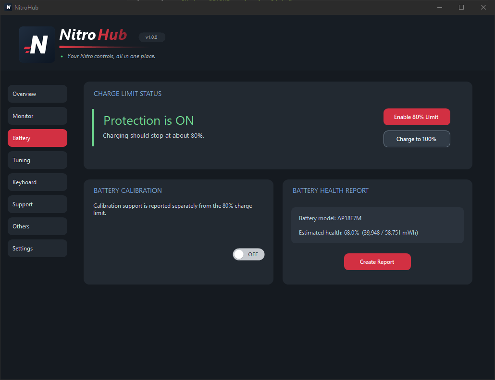
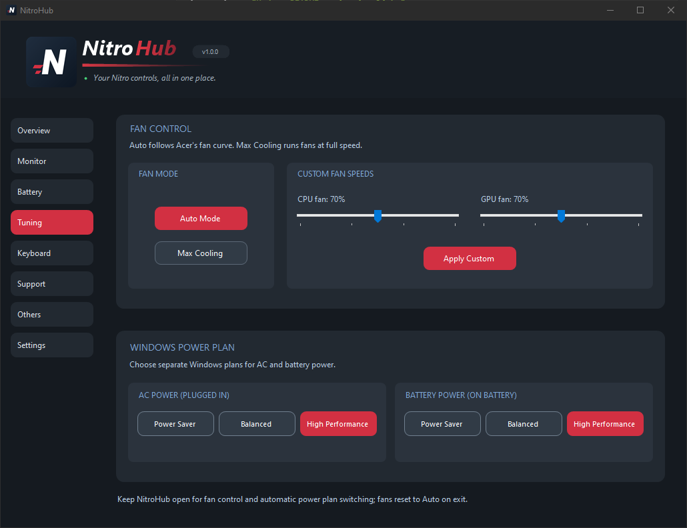
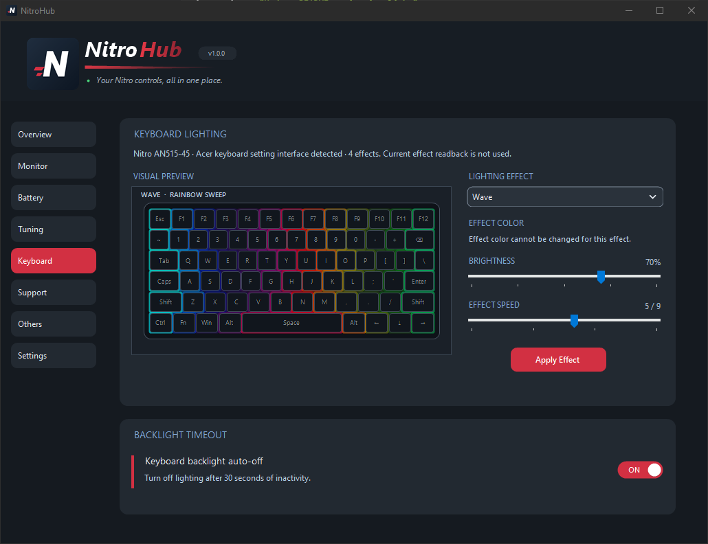
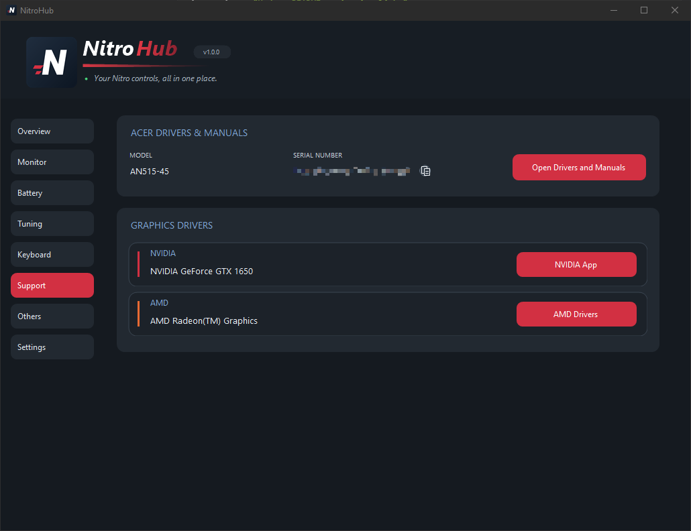
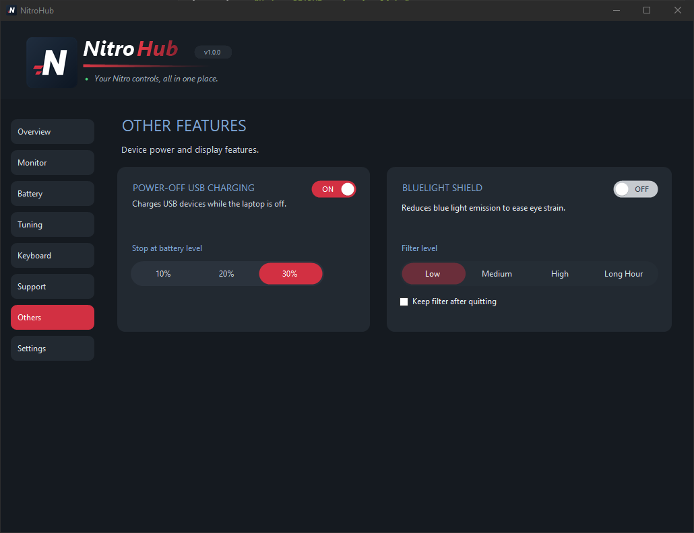
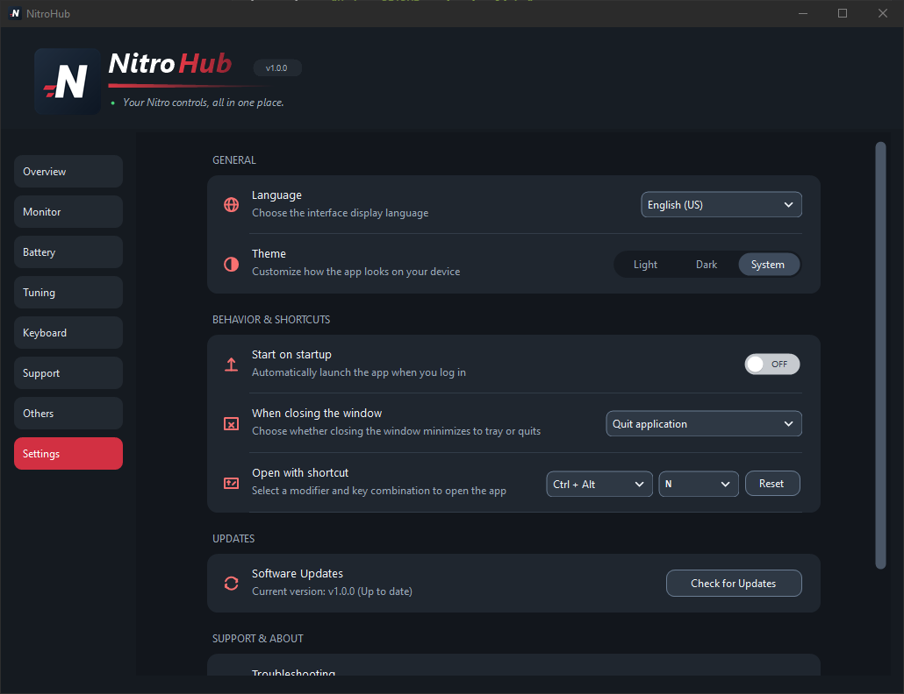

<div align="center">


<br />

**A lightweight, zero-dependency Windows control center for Acer Nitro laptops — unifying Acer Care Center, NitroSense, and Acer Quick Access into one fast app.**

[-0078D6?style=flat-square&logo=windows)](https://www.microsoft.com/windows)
[](https://github.com/NullIsland123/NitroHub/releases)
[](https://dotnet.microsoft.com/)
[](#building-from-source)
[](#8-settings--system-tray)
[](LICENSE)

[Overview](#overview) · [Screenshots](#screenshots) · [Features](#features) · [Requirements](#requirements--compatibility) · [Installation](#installation--usage) · [Build from Source](#building-from-source) · [Project Structure](#project-structure) · [Troubleshooting](#troubleshooting--faq) · [Disclaimer](#disclaimer) · [License](#license)

</div>

<br />

---

> [!WARNING]
> **Unofficial Tool — Read Before Use**
> NitroHub is an independent, community-developed open-source application and is **not affiliated with, endorsed by, or supported by Acer Incorporated**. It directly invokes Acer firmware WMI interfaces, Windows power plans, and display gamma ramps. See the full [Disclaimer](#disclaimer) below before installing or running.

<br />

---

<br />

## Overview

**NitroHub** replaces multiple heavy vendor utilities with a single, fast desktop control panel tailored for Acer Nitro laptops (developed and verified on **Acer Nitro AN515-45**).

Instead of installing and running **Acer Care Center**, **NitroSense**, and **Acer Quick Access** side by side, NitroHub brings all of their everyday hardware controls together under one clean roof.

### Why NitroHub?

- **Three Apps Unified into One (Care Center + NitroSense + Quick Access)** — Combines battery charge limit, calibration & system info (*Acer Care Center*), real-time sensor monitoring, fan control, power plans & keyboard RGB (*NitroSense*), and Power-off USB Charging & Bluelight Shield (*Acer Quick Access*) into a single lightweight executable with zero vendor bloatware or overlapping background services.
- **Zero External Dependencies** — Compiles directly to a single standalone `.exe` using the `.NET Framework 4.x` C# compiler already built into Windows — no Visual Studio, runtime downloads, or third-party DLLs required.
- **Instant Startup & Non-Blocking UI** — Hardware inventory is cached locally and refreshed asynchronously; WMI calls, `powercfg.exe`, and performance counters run off the UI thread on a serialized hardware worker queue.
- **Native Windows 11 Look & Feel** — Supports Light, Dark, and Follow-System themes with seamless DWM title bar coloring, DPI scaling (100%–300%), Snap Layouts, 15 built-in languages, and smooth double-buffered rendering.
- **Sleep & Reboot Resilience** — Restores your saved 80% battery charge limit and display/lighting preferences after sign-in and automatically re-verifies firmware state after waking from sleep.

<br />

---

<br />

## Screenshots

| Overview | Live Monitor |
| :---: | :---: |
|  |  |

| Battery Management | Cooling & Power Tuning |
| :---: | :---: |
|  |  |

| Keyboard Lighting | Support & Drivers |
| :---: | :---: |
|  |  |

| Other Features | Settings |
| :---: | :---: |
|  |  |

<br />

---

<br />

## Features

### 1. Overview
- **Device Identity** — Displays model name, serial number (with one-click copy), BIOS version, and Windows version.
- **Hardware Inventory** — Lists CPU, GPUs, physical memory DIMMs (capacity, DDR type, speed, part number), storage drives, and physical network adapters.
- **Instant Cached Boot** — Loads cached hardware specs immediately on launch and silently refreshes live WMI data in the background.
- **Product Photo Preview** — Fetches and caches an image of your laptop model locally.

### 2. Live Monitor
- **Real-Time Sensors** — Monitors CPU, GPU, and system temperatures (with instant `°C` / `°F` toggle), CPU & GPU utilization, committed RAM usage, and CPU & GPU fan speeds (RPM).
- **Interactive Telemetry Charts** — Smooth anti-aliased area curves for the last hour of temperature and load history, complete with live legend values, vertical hover crosshairs, and floating theme-aware HUD tooltips.

### 3. Battery Management
- **80% Battery Charge Limit** — Toggles Acer's firmware charge cap, persists your preference across full shutdowns via an elevated Windows sign-in scheduled task (`NitroHub Startup`), and automatically restores it if the EC resets after sleep.
- **Battery Calibration** — Toggles firmware-level battery calibration when exposed by your laptop's WMI interface.
- **Battery Health Summary & Report** — Calculates estimated battery health (`FullChargedCapacity / DesignedCapacity` via `root\WMI` with `Win32_Battery` fallback) and generates a full Windows HTML report (`powercfg /batteryreport`) in one click.

### 4. Cooling & Power Tuning
- **Fan Control** — Switch between **Auto**, **Max Cooling**, or **Custom** CPU and GPU fan speeds (safely resets fans back to Auto when exiting NitroHub).
- **Per-Power-Source Power Plans** — Configure separate Windows power plans (**Power Saver**, **Balanced**, **High Performance**) for **Plugged In (AC)** and **On Battery**, switching automatically when the charger is plugged in or unplugged.

### 5. Keyboard Lighting
- **RGB Effect Controls** — Configure firmware-supported keyboard lighting modes, effect speed, brightness, and color with an animated visual preview *(illustrative; Acer firmware does not expose per-key RGB addressing)*.
- **30-Second Backlight Timeout** — Toggle the automatic keyboard backlight inactivity timeout directly via Acer's `APGeAction` interface.

### 6. Support & Drivers
- **Acer Drivers & Manuals** — Opens your model-specific Acer support page using the detected model code, SKU, and serial number.
- **Graphics Vendor Shortcuts** — Automatically detects NVIDIA, AMD, and Intel GPUs and provides direct links to their official driver tools.

### 7. Other Features
- **Power-off USB Charging** — Enable/disable offline USB charging and choose battery cut-off thresholds (**10%**, **20%**, **30%**) directly via Acer `APGeAction`, with optimistic UI response and coalesced rapid clicks.
- **Bluelight Shield** — Native Windows gamma-ramp color filter (**Low**, **Medium**, **High**, **Long Hour**) with optional persistence after exit and automatic re-application after sleep, screen unlock, or display changes.

### 8. Settings & System Tray
- **Appearance** — **Light**, **Dark**, and **System** (automatically follows Windows theme changes).
- **Languages (15 Built-In + Extensible)** — **English (US)**, **简体中文**, **繁體中文**, **Bahasa Melayu**, **日本語**, **한국어**, **Español**, **Français**, **Deutsch**, **Русский**, **Português (Brasil)**, **Bahasa Indonesia**, **Tiếng Việt**, **ไทย**, and **Italiano**. Adding a new language requires zero C# edits: copy `locales/en-US.template.txt` to `locales/<lang>.txt` (embedded automatically on build) or drop a custom `.txt` pack into `%LocalAppData%\NitroHub\locales\`.
- **Global Hotkey & Window Behavior** — Configurable system-wide shortcut (default `Ctrl + Alt + N`) to show/focus NitroHub, start-on-login toggle (battery-safe Task Scheduler XML with no 72-hour kill limit), and close-button behavior (minimize to tray or quit).
- **System Tray Control** — Live CPU/GPU temperature and fan RPM hover tooltip, live status header in the context menu, and quick toggles for charge limit, fan mode, active power plan, keyboard lighting, power-off USB charging, and Bluelight Shield.
- **Built-In Troubleshooting** — Inspect Acer WMI interface health, copy diagnostics, repair the startup task, open the local data folder, or reset all settings to defaults.

<br />

---

<br />

## Requirements & Compatibility

| Requirement | Details |
| --- | --- |
| **Operating System** | Windows 10 or Windows 11 (64-bit) |
| **Runtime** | .NET Framework 4.x *(pre-installed on Windows 10/11)* |
| **Privileges** | Administrator elevation (`requireAdministrator`) for Acer WMI firmware interfaces, scheduled startup task management, and power plan controls |
| **Hardware Support** | Verified on **Acer Nitro AN515-45**; works on other Acer Nitro/Predator laptops that expose `AcerGamingFunction` and/or `APGeAction` under `root\WMI` |

> [!NOTE]
> NitroHub probes firmware capabilities dynamically rather than hard-locking to a single model name. Controls whose underlying WMI interface is absent on a given machine are disabled or marked unavailable without crashing the app.

<br />

---

<br />

## Installation & Usage

### Option A: Windows Installer (Recommended)

1. Download and run `NitroHub-Setup-<version>.exe` from the [Releases page](https://github.com/NullIsland123/NitroHub/releases) (or from `dist\` if building locally).
2. Complete the installation wizard (installs to `C:\Program Files\NitroHub`).
3. Launch **NitroHub** from the Start Menu or Desktop shortcut and approve the UAC prompt.
4. *(Tip)* Enable **Start on startup** and **Minimize to system tray** in **Settings** so NitroHub starts silently at Windows sign-in without UAC prompts and stays ready via the tray icon or global hotkey (`Ctrl + Alt + N`).

### Option B: Portable Executable

1. Place `NitroHub.exe` in a permanent folder (avoid temporary folders if you plan to enable startup restoration).
2. Double-click `NitroHub.exe` and accept the administrator prompt.
3. If you move `NitroHub.exe` later, launch it once from the new folder so the `NitroHub Startup` scheduled task updates its executable path automatically.

### Local Data Storage

All user data stays strictly on your machine under `%LocalAppData%\NitroHub` — **no telemetry or personal data is ever uploaded**.

| Path / File | Purpose |
| --- | --- |
| `settings.ini` | Theme, language, close behavior, global hotkey, Bluelight exit preference |
| `charge-limit-preference.txt` | Saved 80% charge limit state |
| `fan-settings.ini` / `keyboard-settings.ini` | Saved fan mode/speeds and keyboard lighting configuration |
| `power-plans.ini` | Separate AC and Battery Windows power plan GUIDs |
| `hardware-cache.txt` / `product-photo.png` | Cached hardware inventory and laptop image for instant startup |
| `locales\*.txt` | Optional user-supplied or override language packs (loaded automatically on launch) |
| `logs\` / `reports\` | Startup/crash logs and generated Windows HTML battery health reports |

<br />

---

<br />

## Building from Source

No Visual Studio, MSBuild, or NuGet packages are required.

### 1. Build `NitroHub.exe`

```powershell
powershell -ExecutionPolicy Bypass -File .\Build-NitroHub.ps1
```

Output: `dist\NitroHub.exe`

### 2. Build with a Custom Version

Pass `-Version` to automatically synchronize `AssemblyVersion`, `AssemblyFileVersion`, and `AssemblyInformationalVersion` (reflected in the app badge, About dialog, and Windows file properties):

```powershell
powershell -ExecutionPolicy Bypass -File .\Build-NitroHub.ps1 -Version 1.1.0
```

### 3. Build the Inno Setup Installer

Install [Inno Setup 6](https://jrsoftware.org/isinfo.php) once (e.g., `winget install JRSoftware.InnoSetup`), then run:

```powershell
powershell -ExecutionPolicy Bypass -File .\Build-NitroHub.ps1 -Version 1.0.0 -Installer
```

Outputs:
- `dist\NitroHub.exe`
- `dist\NitroHub-Setup-1.0.0.exe`
- `dist\NitroHub-Uninstaller.exe` *(standalone uninstaller for both installed and portable copies)*

<br />

---

<br />

## Project Structure

```text
NitroHub/
├── src/
│   ├── NitroHubApp.cs             # Complete C# WinForms application source
│   └── NitroHub.manifest          # UAC administrator elevation manifest
├── assets/
│   ├── NitroHub.ico               # Multi-size app & system tray icon (up to 256x256)
│   ├── NitroHubLogo.png           # Embedded application header logo
│   ├── NitroHubBanner.jpg         # GitHub README hero banner
│   └── Screenshots/               # Application screenshots displayed in README.md
├── locales/
│   ├── en-US.template.txt         # Template for contributing new language packs
│   └── *.txt                      # 14 embedded UI translation packs (auto-discovered on build)
├── installer/
│   ├── NitroHub.iss               # Inno Setup 6 Windows installer script
│   └── NitroHubUninstaller.cs     # Standalone uninstaller utility source
├── dist/                          # Build outputs (gitignored: EXE, Setup & Uninstaller)
├── Build-NitroHub.ps1             # One-command build & packaging script
├── .gitignore                     # Git ignore rules
├── .gitattributes                 # Cross-platform line-ending & binary rules
├── LICENSE                        # GNU GPL-3.0 License
└── README.md                      # Project documentation
```

<br />

---

<br />

## Troubleshooting & FAQ

### Why does Windows ask for Administrator permission (UAC) on launch?
Acer's hardware WMI endpoints (`root\WMI\AcerGamingFunction` and `root\WMI\APGeAction`) and Task Scheduler operations require elevation. To avoid daily UAC prompts, enable **Start on startup** in **Settings** (which creates an elevated sign-in task) and leave NitroHub running quietly in the system tray.

### Some controls show as unavailable / disabled on my laptop
Different Acer models and BIOS versions expose different subsets of WMI methods. Open **Settings → Troubleshooting** to view the live status of each detected Acer interface and export a diagnostic summary.

### What happens to fan speeds and Bluelight Shield when I exit NitroHub?
- **Fans** automatically return to **Auto** mode on exit so your laptop is never left stuck at a fixed manual speed.
- **Bluelight Shield** resets display gamma ramps to normal on exit by default, unless you check **Keep filter active after NitroHub closes**.

### How do I cleanly uninstall everything?
- **Installed version**: Uninstall **NitroHub** from Windows **Settings → Apps**, via **Start Menu → NitroHub → Uninstall NitroHub**, or by running the standalone `NitroHub-Uninstaller.exe`.
- **Portable version**: Run `NitroHub-Uninstaller.exe` to cleanly stop NitroHub, delete the `NitroHub Startup` scheduled task, and optionally remove `%LocalAppData%\NitroHub`.

<br />

---

<br />

## Disclaimer

1. **No Official Affiliation** — NitroHub is an independent, unofficial open-source project. It is **not** created by, affiliated with, endorsed by, or officially supported by **Acer Incorporated**. All product names, logos, and trademarks (including *Acer*, *Nitro*, *NitroSense*, *Acer Care Center*, *Acer Quick Access*, *Predator*, *NVIDIA*, *AMD*, and *Intel*) are the property of their respective owners.
2. **Firmware & Hardware Risk** — This software communicates directly with embedded controller (EC) and BIOS WMI interfaces to adjust battery charging thresholds, fan speeds, keyboard lighting, USB power delivery, and display color gamma curves. Firmware interfaces are undocumented and may behave differently across laptop models or BIOS updates.
3. **No Warranty** — NitroHub is provided **"AS IS"**, without warranty of any kind, express or implied, including but not limited to warranties of merchantability, fitness for a particular purpose, or non-infringement. The authors and contributors shall **not** be held liable for any hardware damage, overheating, battery degradation, data loss, system instability, or warranty implications resulting from the use or misuse of this software.
4. **Use Responsibly** — Always monitor temperatures when using manual/custom fan curves and ensure adequate cooling under sustained CPU/GPU loads.

<br />

---

<br />

## License

This project is licensed under the **GNU General Public License v3.0 (GPL-3.0)** — see the [LICENSE](LICENSE) file for full details.
